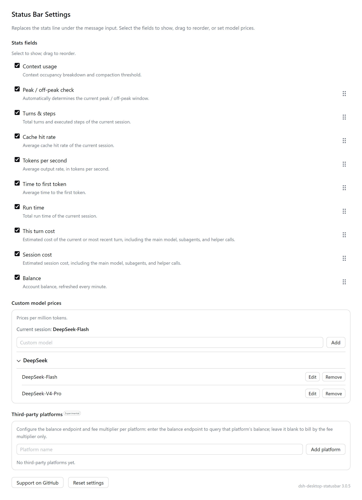

<h1 align="center">dsh-desktop-statusbar</h1>

<p align="center">
  <a href="https://github.com/raphael-y7/dsh-desktop-statusbar/stargazers"></a>
  <a href="https://www.npmjs.com/package/dsh-desktop-statusbar"></a>
  <a href="https://www.npmjs.com/package/dsh-desktop-statusbar"></a>
  <a href="https://github.com/deepseek-ai/deepseek-harness"></a>
  <a href="https://awesome-dsh-plugin.com/p/raphael-y7/dsh-desktop-statusbar/"></a>
  <a href="https://dshfind.com/zh/plugins/raphael-y7/dsh-desktop-statusbar"></a>
  <a href="https://deepseek1024.com/plugins/Rapheal-Y7/dsh-desktop-statusbar"></a>
  <br>
  <a href="https://nodejs.org/"></a>
  
  <a href="LICENSE"></a>
</p>

<p align="center"><a href="README.md">简体中文</a> | <a href="README.en.md">English</a> | <a href="README.ja.md">日本語</a> | <a href="README.es.md">Español</a> | <a href="README.fr.md">Français</a> | <a href="README.de.md">Deutsch</a> | <a href="README.ru.md">Русский</a> | <a href="README.pt.md">Português</a></p>

Ersetzt die Statistikzeile unter der Nachrichteneingabe in der DSH-Desktop-App durch eine konfigurierbare Statusleiste: Felder, Reihenfolge, Preise pro Modell und Währung sind alle konfigurierbar, mit Live-Kostenschätzungen anhand der offiziellen Peak-/Off-Peak-Tarife von DeepSeek.

https://github.com/user-attachments/assets/5a4f7fd8-a445-490d-a557-1ec840c611df

## Funktionen

- **9 optionale Felder plus der Kontextring**: Kontextauslastung (der Ring am Anfang der Leiste), Peak-/Off-Peak-Prüfung, Runden & Schritte, Cache-Trefferquote, Ausgabegeschwindigkeit, TTFT, Laufzeit, Kosten dieser Runde, Sitzungskosten, Guthaben
- **Für Details auf ein Feld klicken**:

  | Feld | Inhalt |
  | --- | --- |
  | Kontextring (Leistenanfang) | System-Prompt / Tool-Definitionen / Nachrichten |
  | Peak-/Off-Peak-Prüfung | Nutzungs-Heatmap: Tag / Woche / Monat / Jahr |
  | Runden & Schritte | Kontextkomprimierungen / injizierte Skills / Tool-Aufrufe |
  | Kombinierte Trefferquote | Diese Runde / höchste / niedrigste Cache-Trefferquote |
  | TPS | Diese Runde / schnellste / langsamste Geschwindigkeit |
  | TTFT | Diese Runde / schnellste / langsamste Verzögerung bis zum ersten Token |
  | Laufzeit | Wartezeit / Modellzeit / Tool-Aufrufe |
  | Kosten dieser Runde | Token-Aufschlüsselung für diese Runde |
  | Sitzungskosten | Kumulative Token-Aufschlüsselung für diese Sitzung |
  | Guthaben | Aufgeladenes Guthaben / gewährtes Guthaben / verbleibendes Kontingent |

- **Drill-down der Sitzungsdaten**: Kontextkomprimierungen markieren den Knoten, an dem sie stattfanden, „injizierte Skills“ zählt die in dieser Sitzung injizierten Skills, und Tool-Aufrufe listen jedes von der Sitzung verwendete Tool mit seiner Aufrufzahl auf; klicken Sie auf den Titel, um zurückzugehen
- **Versionsprüfung und Update**: DSH prüft beim Start auf die neueste Version, zeigt einen Hinweis neben dem Navigationspunkt „Statusleiste“, wenn eine verfügbar ist, und bietet in den Einstellungen eine Schaltfläche zum Ein-Klick-Update an
- **GitHub-Unterstützung**: Die Schaltfläche öffnet die GitHub-Projektseite, auf der Sie das Projekt mit einem Stern versehen können.
- **Kostenschätzung**: bepreist nach den offiziellen Peak-/Off-Peak-Regeln; jeder Aufruf wird anhand des Zeitpunkts, an dem er stattfand, und des verwendeten Modells berechnet
- **Preisbuch**: eigene Preise, eine optionale Peak-/Off-Peak-Aufteilung und ein Währungsumschalter CNY / USD
- **Außerdem**: automatische Feiertagsaktualisierungen, Guthaben jede Minute aktualisiert, 8 Oberflächensprachen (简体中文 / English / 日本語 / Español / Français / Deutsch / Русский / Português)

## Installation

Öffnen Sie in der DSH-Desktop-App **Plugins → Plugin hinzufügen** und installieren Sie nach Paketnamen:

```
dsh-desktop-statusbar
```

Wo die npm-Registry nicht erreichbar ist, bietet derselbe Dialog den Mirror für das chinesische Festland als Installationsquelle an. Eine GitHub-Repository-URL wird ebenfalls akzeptiert:

```
https://github.com/raphael-y7/dsh-desktop-statusbar
```

Kommandozeile:

```powershell
dsh plugin --profile desktop add dsh-desktop-statusbar
```

### Installation von npm

Beide oben genannten Wege installieren aus der npm-Registry; der Paketname lautet `dsh-desktop-statusbar`. Um die aktuelle Version auf npm zu prüfen:

```powershell
npm view dsh-desktop-statusbar version
```

### Wenn der integrierte Updater fehlschlägt

Die integrierte Schaltfläche für das Ein-Klick-Update kann bei manchen Desktop-Builds fehlschlagen — sie reagiert entweder nicht oder meldet einen Fehler. Verwenden Sie in diesem Fall den offiziellen Installationseingang und **hängen Sie `@version` an den Paketnamen an**, um die genaue Version zu installieren:

```powershell
dsh plugin --profile desktop add dsh-desktop-statusbar@3.0.5
```

Derselbe String funktioniert im Plugin-Panel: Geben Sie `dsh-desktop-statusbar@3.0.5` in das Feld **Plugin hinzufügen** ein.

Verwenden Sie die aktuell neueste Version (angezeigt auf der Release-Seite oder in der obigen `npm view`-Ausgabe). Das Festlegen der Version stellt außerdem sicher, dass **Sie genau die Ziel-Build installieren**, wodurch ein veraltetes zwischengespeichertes Paket vermieden wird.

Ebenfalls gelistet auf [dshmarket](https://awesome-dsh-plugin.com/p/raphael-y7/dsh-desktop-statusbar/), [dshfind](https://dshfind.com/zh/plugins/raphael-y7/dsh-desktop-statusbar) und [1024Store](https://deepseek1024.com/plugins/Rapheal-Y7/dsh-desktop-statusbar).

## Verwendung

Öffnen Sie **Einstellungen → Statusleiste**:



- **Kontextauslastung**: der Ring am Anfang der Leiste — der Fortschritt zeigt den verbrauchten Kontextanteil, die Lücke markiert die Komprimierungsschwelle und die Farbe zeigt den Ausführungszustand (inaktiv-grau / läuft-grün / Sub-Agent läuft-blau / tieferer Sub-Agent läuft-violett / Fehler-rot / wartet auf Genehmigung-bernstein)
- **Statistikfelder**: Das Ankreuzen steuert nur die Sichtbarkeit, daher blendet das Entfernen des Häkchens ein Feld aus, ohne es zu verschieben; ziehen Sie den Griff auf der rechten Seite, um die Reihenfolge zu ändern; „Einstellungen zurücksetzen“ stellt die Werkseinstellung wieder her
- **Benutzerdefinierte Modellpreise**: Geben Sie einen Modellnamen ein und klicken Sie auf „Hinzufügen“, um einen Eintrag zu erstellen; „Bearbeiten“ öffnet den Editor, und Änderungen werden beim Speichern geschrieben; aktivieren Sie „Peak-/Off-Peak-Preisgestaltung“, um nach Tageszeit aufzuteilen, andernfalls gilt ein pauschaler Ganztagspreis
- **Währung**: CNY oder USD in der oberen rechten Ecke des Editors. Beim Umschalten werden die beiden integrierten Modelle durch die offiziellen Referenzpreise dieser Währung ersetzt (bearbeitete Einträge bleiben erhalten) und das Symbol in den Kostenfeldern geändert; das Guthaben folgt der von der API gemeldeten Währung
- **Feiertage**: holt und schreibt nach dem 31. Dezember jedes Jahres automatisch den Kalender des nächsten Jahres
- **Guthaben**: einmal pro Minute aktualisiert

### Abrechnungsregeln

Die Peak-Zeiten sind **09:00–12:00 und 14:00–18:00 Pekinger Zeit, Montag bis Freitag**, und die Off-Peak-Tarife betragen die Hälfte der Peak-Tarife; chinesische Feiertage und Wochenenden werden ganztägig zum Off-Peak-Tarif abgerechnet (entsprechend der [offiziellen Dokumentation](https://api-docs.deepseek.com/quick_start/pricing), geprüft im September 2026).


## Guthabenabfrage für Relais

Bei der Guthabenabfrage wählt die Statusleiste das Abfrageverfahren anhand **der tatsächlich von der aktuellen Sitzung genutzten Plattform**; es gibt zwei Fälle: automatische Zuordnung und manuelle Konfiguration.

### 1. Automatische Zuordnung

Wenn das Relais auf der DSH-Seite **Modelle** als normaler Provider konfiguriert ist (mit baseURL und API-Schlüssel), prüft das Plugin mit diesem Schlüssel parallel die folgenden gängigen Guthaben-Endpunkte; sobald ein auswertbarer Endpunkt antwortet, wird das Guthaben ohne weitere Konfiguration angezeigt:

- `/v1/usage`
- `/v1/user/self`, `/api/user/self`, `/api/v1/user/self`
- `/api/usage`
- `/v1/dashboard/billing/credit_grants`
- `/v1/credits`

Entspricht der Guthaben-Endpunkt der Site einer der oben genannten Standardformen und ist er über `Authorization: Bearer <API-Schlüssel>` lesbar, wird das Guthaben automatisch angezeigt.

### 2. Manuelle Konfiguration

In einem der folgenden Fälle müssen Sie unter **Einstellungen → Statusleiste → Benutzerdefinierte Modellpreise → Plattform** einen Plattform-Eintrag hinzufügen und Endpunkt sowie Anmeldedaten eintragen:

- der Provider hat auf der Seite **Modelle** keine baseURL konfiguriert;
- der Guthaben-Endpunkt oder das Authentifizierungsverfahren entspricht keiner Standardform (z. B. benötigt New API einen zusätzlichen User-ID-Request-Header);
- die Antwortstruktur des Endpunkts lässt sich nicht automatisch auswerten.

Die Felder sind wie folgt definiert:

| Feld | Beschreibung | Beispiel |
| --- | --- | --- |
| Request-Header | Name des Request-Headers für die Benutzer-ID; die Token-Authentifizierung verwendet stets `authorization: Bearer` und muss nicht eingetragen werden | `New-Api-User` |
| Benutzer-ID | Die Benutzerkennung für den obigen Request-Header | `12345` |
| Token | New API: „Zugriffstoken“ (das System-Zugriffstoken in den persönlichen Einstellungen) eintragen; Sub2API: „Anmeldetoken“ eintragen; gewöhnliches Relais: den für Modellaufrufe verwendeten `sk-` Schlüssel eintragen | `sk-...` |
| Guthaben-Endpunkt | Vollständige URL des Guthaben-Endpunkts | `https://example.com/api/user/self` |
| Guthabenfeld | Währungssymbol, Feldpfad und Divisor im Format `<Währung><Feldpfad> / <Divisor>` | `$data.quota / 500000` |
| Geeignete Modelle | Modelle, die zu dieser Plattform gehören | — |
| Kostenmultiplikator | Preisgestaltungsmultiplikator, Standard 1 | `1` |

#### Beispiel 1: New-API-kompatible Site

- Guthaben-Endpunkt: `https://example.com/api/user/self`
- Guthabenfeld: `$data.quota / 500000` (diese Site rechnet 500000 Kontingent als 1 Yuan)
- Token: das in den persönlichen Einstellungen erzeugte Zugriffstoken (kein Modellaufruf-Schlüssel)
- Request-Header: `New-Api-User`; Benutzer-ID: die Konto-Benutzer-ID

#### Beispiel 2: Sub2API-Site

Der Guthaben-Endpunkt von Sub2API-Sites hat häufig eine der folgenden beiden Formen; wählen Sie je nach Site:

- Unterstützt OpenAI-kompatibles `GET /v1/usage` (Authentifizierung mit dem `sk-` Modellschlüssel): wird in der Regel automatisch zugeordnet, keine manuelle Konfiguration nötig; bei fehlender Zuordnung das Token auf diesen `sk-` Schlüssel und den Guthaben-Endpunkt auf `https://example.com/v1/usage` setzen.
- Nur ein Konsolen-Endpunkt ist abfragbar (der Endpunkt liegt unter `/api/v1/*` und erfordert eine Konsolen-Anmeldung): den Guthaben-Endpunkt auf den Konsolen-Guthaben-Endpunkt der Site (gemäß tatsächlicher Site) setzen, **das Token auf das „Anmeldetoken“** setzen (die nach der Konsolen-Anmeldung erhaltene Zugriffsberechtigung, kein Modellaufruf-Schlüssel), und das Guthabenfeld gemäß der Antwortstruktur des Endpunkts eintragen.

#### Beispiel 3: OpenAI-kompatibles Relais mit einem einzigen Schlüssel

- Token: der für Modellaufrufe verwendete `sk-` Schlüssel
- Wird in der Regel automatisch zugeordnet; bei fehlender Zuordnung den Guthaben-Endpunkt und das Guthabenfeld (z. B. `$balance` oder `$data.balance`) ergänzen.

> Hinweis: Bleibt der Guthaben-Endpunkt leer, wird das Guthaben dieser Plattform nicht abgefragt; sie nimmt jedoch weiterhin über den Kostenmultiplikator an der Abrechnung teil.

## Bekannte Einschränkungen

- Die schnellste / langsamste TTFT und Geschwindigkeit stammen aus einer neuen hostseitigen Projektion: **Sie müssen DSH vollständig beenden und neu starten**, bevor es mit der Erfassung beginnt
- Ein Modell ohne Preis wird nicht abgerechnet; das Hinzufügen des Preises füllt seine früheren Aufrufe nachträglich auf
- Das Ein-Klick-Update basiert auf `pnpm`: Die Desktop-App verwendet die mit dem Host gebündelte Kopie, während die Nutzung über CLI / Web `pnpm` im System erfordert. Wird keines gefunden, weist das Update ausdrücklich darauf hin **und protokolliert jeden versuchten Speicherort**; Sie können es auch über die Umgebungsvariable `DSH_DESKTOP_STATUSBAR_PNPM` auf einen bestimmten Befehl verweisen

## Berechtigungen & externer Zugriff

Das Plugin liest Sitzungsprotokolle und lokale Konfiguration, um Nutzung, Guthaben und Kosten zu berechnen, und unterstützt das Ein-Klick-Selbstupdate, daher ist es ein **hochprivilegiertes Plugin**. Unten folgt die tatsächliche Berechtigungsgrenze (entsprechend dem Code in `lib/`). Bitte überprüfen Sie sie vor der Installation.

### Dateien

| Pfad | Zweck | Hinweise |
| --- | --- | --- |
| `<DSH_HOME>/dsh-status-bar/usage-ledger.json` | Lokales Nutzungs-Ledger, beim Start aus dem Verlauf nachbefüllt | Schreibt nur im eigenen Verzeichnis des Plugins |
| `<DSH_HOME>/dsh-status-bar/holidays.json` | Cache für Feiertage | Wird bei automatischen Feiertagsaktualisierungen im Hintergrund geschrieben |
| `<DSH_HOME>/dsh-status-bar/exchange-rate.json` | Täglicher Wechselkurs-Cache | Wird beim Aktualisieren der Wechselkurse im Hintergrund geschrieben |
| `<DSH_HOME>/dsh-status-bar/tip-diag.log` | Diagnoseprotokoll | Zeichnet Diagnosedaten zur Tooltip-Positionierung zur Fehlerbehebung auf |
| `<DSH_HOME>/dsh-status-bar/relay-balance.json` | Relay-Guthaben-Konfiguration (kein Klartext-Geheimnis) | Plugin-Verzeichnis |
| `<DSH_HOME>/sessions` | Sitzungsprotokolle lesen, um Token-/Kostenstatistiken zu berechnen | Nur lesen |
| `<DSH_HOME>/.credentials.yaml` | Liest API-Schlüssel nur über Refs, wenn weder der Credentials-Dienst noch Umgebungsvariablen einen bereitstellen | Nur lesen |
| Profil `package.json` / `pnpm-lock.yaml` / `pnpm-workspace.yaml` | Beim Ein-Klick-Selbstupdate gesichert und zurückgeschrieben | Nur wenn Sie auf „Ein-Klick-Update“ klicken |

### Netzwerk

Anfragen werden nur gestellt, um Guthaben, Wechselkurse oder Feiertage anzuzeigen oder auf Updates zu prüfen; alle außer dem lokalen Loopback 127.0.0.1 über HTTPS, und sie schlagen bei Zeitüberschreitung still fehl, ohne die anderen Statusleistenfelder zu blockieren.

| Domäne | Zweck |
| --- | --- |
| `api.deepseek.com` | DeepSeek-Kontoguthaben |
| `openrouter.ai` | OpenRouter-Guthaben |
| `api.siliconflow.com` / `api.siliconflow.cn` | SiliconFlow-Kontoinformationen |
| `api.moonshot.ai` / `api.moonshot.cn` | Moonshot-Guthaben |
| `open.bigmodel.cn` / `api.z.ai` | Zhipu-Kontingent |
| `api.b.ai` | B.AI-Guthaben |
| `api.xiaomimimo.com` | Xiaomi MiMo-Guthaben |
| `api.stepfun.com` / `api.stepfun.ai` | StepFun-Kontoguthaben (China / International) |
| `www.minimax.cn` | MiniMax Token Plan-Kontingent |
| `management-api.x.ai` | xAI-Team-Guthaben |
| `business.aliyuncs.com` | Alibaba Cloud BSS-Kontoguthaben |
| `open.er-api.com` | CNY-Wechselkurs |
| `sousuo.www.gov.cn` | Automatische Aktualisierung der gesetzlichen Feiertage |
| `registry.npmjs.org` | Versionsprüfung (Selbstupdate) |
| `127.0.0.1` (Loopback) | Host-Web-Port / lokale Adapter |

Wenn die Guthaben-URL einer Plattform leer gelassen wird, wird sie nicht abgefragt, was die Abrechnung nicht beeinflusst.

### Anmeldedaten

- Verwendet zuerst den Anmeldedaten-Dienst des Hosts `ctx.credentials` (die maßgebliche Quelle, die von der Modelle-Seite geschrieben wird); ist er nicht verfügbar, wird auf Umgebungsvariablen zurückgegriffen (z. B. `DEEPSEEK_API_KEY` und den Refs-Namen jedes Adapters), dann auf den Refs-Abschnitt von `<DSH_HOME>/.credentials.yaml`.
- API-Schlüssel werden **nur zum Abfragen des Guthabens dieser Plattform verwendet**; sie werden niemals woanders hochgeladen, protokolliert oder in das Ledger geschrieben.
- Die Einstellungsseite zeigt Token als Punkte mit Auswahl-zum-Kopieren; `GET /dsh-desktop-statusbar/api/relay-balance-config` gibt das Same-Origin-Token an das Frontend zurück. Dieser Endpunkt ist nur über Loopback erreichbar (Prüfungen von Host / Origin / remoteAddress) und verlässt niemals den Rechner.

### Befehle

- `pnpm` wird nur aufgerufen, wenn Sie auf „Ein-Klick-Update“ klicken: Es wird das mit dem Host gebündelte pnpm bevorzugt (z. B. `runtime/primary-runtime/dependencies/pnpm/bin/pnpm.mjs`), mit Rückgriff auf das System-`pnpm`; Sie können es mit der Umgebungsvariable `DSH_DESKTOP_STATUSBAR_PNPM` festlegen.
- Bei einem Fehler stellt das Update das Profil-Backup wieder her und zeigt den Grund an; wenn pnpm nicht gefunden wird, meldet es dies ausdrücklich und protokolliert jeden versuchten Speicherort.

### Fehlergrenzen

- Keine Anmeldedaten: Das Guthaben dieser Plattform zeigt „—“; andere Felder funktionieren weiter.
- Netzwerkfehler / Zeitüberschreitung: Nur dieses Guthaben oder dieser Kurs ist betroffen; andere Statistiken sind nicht betroffen.
- pnpm nicht gefunden: Das Ein-Klick-Update meldet explizit einen Fehler, statt still zu scheitern.
- Selbstupdate-Fehler: Das `package.json`- / Lockdatei-Backup des Profils wird wiederhergestellt.

### Bekannte Risiken

- Hochprivilegiertes Plugin (Datei lesen/schreiben + Netzwerk + Anmeldedaten + Befehle) — bitte entscheiden Sie nach Kenntnis des Berechtigungsumfangs, ob Sie es installieren.
- Wenn externe Guthabendienste nicht verfügbar sind, fehlen die zugehörigen Zahlen oder sind veraltet.
- Das Ein-Klick-Selbstupdate benötigt Schreibzugriff auf das Profil-Verzeichnis.

## Entwicklung

Jeder Test ist ein eigenständiges Skript, das mit reinem node ausgeführt werden soll — kein Test-Framework.

```powershell
npm test          # runs every verify*.js/.mjs under tests/, then checks project vs installed plugin dir
npm run sync      # copies lib/ into the installed plugin dir
```

Entwicklungsskripte unter `tools/` werden mit dem Paket ausgeliefert (das Feld `files` enthält sie),
sodass sowohl ein Git-Klon als auch eine npm-Installation sie erhalten:

| Skript | Zweck |
|---|---|
| `tools/test.cjs` | vollständiger Testlauf + Konsistenzprüfung |
| `tools/sync-to-plugin.cjs` | Projekt-`lib/` → installiertes Plugin-Verzeichnis |
| `tools/sync-from-plugin.cjs` | installiertes Plugin-Verzeichnis → Projekt-`lib/` |
| `tools/plugin-dir.cjs` | lokalisiert das Plugin-Verzeichnis |
| `tools/shot.cjs` | erzeugt die README-Screenshots neu |

Sie werden nur während der Entwicklung verwendet; das Plugin lädt sie zur Laufzeit nie.
Das npm-Paket enthält `tests/` und `tools/`, sodass eine installierte Kopie `node tools/test.cjs` direkt
ausführen kann (vollständiger Testlauf + Konsistenzprüfung).

Das Plugin-Verzeichnis wird automatisch lokalisiert: Umgebungsvariable `DSH_STATUS_BAR_PLUGIN_DIR` →
bekannte Layouts unter `~/.dsh` (`local-plugins/`, jedes `profiles/*/node_modules/`) → abgeleitet vom
`tools/`-Speicherort. Beim Wechsel von Rechner oder Benutzernamen sind keine Codeänderungen erforderlich.

## Lizenz

[MIT](LICENSE): frei zu verwenden, zu ändern und weiterzuverbreiten; behalten Sie den Urheberrechts- und Lizenzhinweis bei.