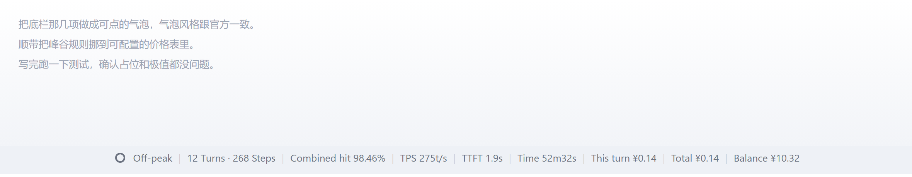
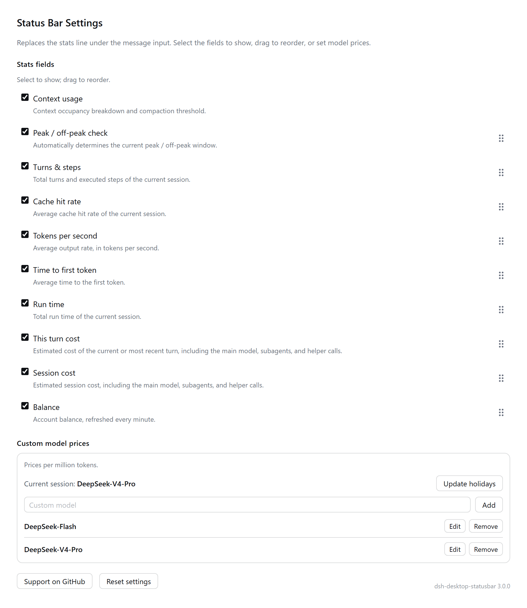
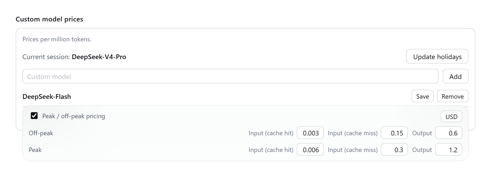

<h1 align="center">dsh-desktop-statusbar</h1>

<p align="center">
  <a href="https://github.com/raphael-y7/dsh-desktop-statusbar/stargazers"></a>
  <a href="https://www.npmjs.com/package/dsh-desktop-statusbar"></a>
  <a href="https://www.npmjs.com/package/dsh-desktop-statusbar"></a>
  <a href="https://github.com/deepseek-ai/deepseek-harness"></a>
  <a href="https://awesome-dsh-plugin.com/p/raphael-y7/dsh-desktop-statusbar/"></a>
  <a href="https://dshfind.com/zh/plugins/raphael-y7/dsh-desktop-statusbar"></a>
  <a href="https://deepseek1024.com/plugins/Rapheal-Y7/dsh-desktop-statusbar"></a>
  <br>
  <a href="https://nodejs.org/"></a>
  
  <a href="LICENSE"></a>
</p>

<p align="center"><a href="README.md">中文</a> | English</p>

Replaces the stats line under the message input in the DSH desktop app with a configurable status bar: fields, ordering, per-model prices and currency are all configurable, with live cost estimates using DeepSeek's official peak/off-peak rates.



## Features

- **10 optional fields**: context occupancy (the ring at the head of the bar), peak / off-peak check, turns & steps, cache hit rate, output speed, TTFT, run time, this turn cost, session cost, balance
- **Click a field for details**:

  | Field | Content |
  | --- | --- |
  | Context ring (bar head) | System prompt / tool definitions / messages |
  | Peak / off-peak check | Usage heat map: day / week / month / year |
  | Turns & steps | Context compactions / skills injected / tool calls |
  | Combined hit | This turn / highest / lowest cache hit rate |
  | TPS | This turn / fastest / slowest speed |
  | TTFT | This turn / fastest / slowest first-token delay |
  | Run time | Wait time / model time / tool calls |
  | This turn cost | Token breakdown for this turn |
  | Session cost | Cumulative token breakdown for this session |
  | Balance | Top-up balance / granted balance / quota left; for WorkBuddy credit sessions, "Points packages" |

- **Session data drill-down**: context compactions mark the node they happened at (only **successful** compactions are listed, and a manual `/compact` gets a superscript asterisk at the end of the row); each injected skill is listed **once, with no call count**, sorted by name length — shorter names first, longer ones later (`AGENTS.md`-style global instructions are pinned first; manually invoked skills get a superscript asterisk); tool calls are listed under their raw tool names (see the next bullet for display and ordering); click the title to go back up
- **Raw tool names**: tool calls show the **original English tool name** — no translation, no Chinese name mapping; rows sort by name length ascending, then call count descending, then lexicographically; identical names are listed once with a count (different tools have different names and therefore never merge); **never wraps** — when it does not fit, the rows per column step up (3 by default → 4 → 5 …, up to 12), and because more rows means fewer columns the bubble narrows accordingly; only when 12 rows per column is still not enough does it switch to horizontal scrolling. Going back up a level resets to 3 rows.
- **Tool colour bar**: the bar under the title of the tool-call sub-view assigns colours by **display order** from a 32-colour palette (8 per row, light to saturated); the 33rd tool wraps back to colour 1. Each segment's width is that tool's call count ÷ the total.
- **Tool bar hover**: hovering a segment shows **one 11px line of plain text** (tool name + percentage, two decimals) — no bubble, no shadow. The text is **vertically fixed** (centred on the bubble's title row, it does not follow the pointer up and down) and only moves horizontally with the pointer, clamped between the "Tool calls" title's right edge +1 character and the bar's right edge.
- **Segment hover lift**: hovering lifts the segment to `scaleY(1.45)` with capsule corners kept, and the hit area extends 7px above and below. This effect is **only enabled in the tool-call sub-view** — balance / duration bars do not participate.
- **Subagent usage tint**: when subagent usage exists, the token breakdown bar in the "This turn cost" / "Session cost" bubble splits into 6 segments with the **subagent block on the left and the main-session block on the right**: [sub·hit 75% grey][sub·miss main colour][sub·output main colour][main·hit grey][main·miss purple][main·output blue]. The number and the three detail rows stay merged (main session + subagents) and no extra row is added.
- **WorkBuddy points packages**: in a WorkBuddy (dsh-connect-workbuddy) session the balance is points; clicking the balance bubble lists the "Points packages" — each package is one block: name plus (the refresh date for a monthly package / the expiry date for a one-off package), used / total, and its own progress bar; adjacent packages with the same display name merge into one "name×N" block (the nearest date is shown, marked "(nearest)", with the group's combined used / total on the right), and clicking an aggregated block drills into each original package with its own name, date and used / total (up to 5 blocks on screen, scrollable, click the title to go back). **Package names keep the upstream original text and are not translated** (the global site will keep adding new packages; a mapping table is bound to go stale, and a missed translation is worse than none). The China site's channel prefixes (`CodeBuddy` / `个人版` / `国内`) are stripped **purely locally**, leaving the clean package name (e.g. `CodeBuddy个人版国内运营裂变包` → `运营裂变包`), which is what both UIs display. The data comes from the local read-only route `/plugins/dsh-connect-workbuddy/usage` (`credits.packages[]`): no extra network requests, no credentials touched, and the third-party plugin is not modified; when there is no package data the bubble stays non-clickable.
- **Version check and update**: DSH checks for the latest version on startup, shows a hint next to the "Status bar" nav item when one is available, and offers a one-click update button in settings
- **GitHub support**: your support is the biggest motivation for the developer to keep going! Click the button to open the GitHub project page and help with a star — thanks, everyone!
- **Cost estimation**: priced with the official peak/off-peak rules; each call is computed from the moment it happened and the model it used
- **How the total is computed**: every call is **settled exactly once** and then frozen — editing a price never rewrites money already recorded. Tokens produced after a price change are settled at the **new** rate. If a model had no price at the time, its tokens are booked as a **debt**; when you add the price, only that debt is settled, and the historical amount stays untouched. The subagent portion of the bar uses a "current − already counted" delta so it is never added twice; it has no per-call timestamps, so its peak/off-peak tier can only be estimated from the current period.
- **No flickering total**: subagent usage is fetched by a separate request and can time out or arrive late with hundreds of sub-sessions. On a failed sample it keeps the last value (it never drops back to a dash) and never moves backwards. The subagent usage timeout is 20 seconds, giving large teams time to aggregate.
- **Price book**: your own prices, an optional peak/off-peak split, and a CNY / USD currency switch
- **Also**: one-click holiday calendar update, balance refreshed every minute, bilingual UI, tool calls show raw tool names

## Install

In the DSH desktop app, open **Plugins → Add plugin** and install by package name:

```
dsh-desktop-statusbar
```

Where the npm registry is not reachable, the same dialog offers the China mainland mirror as the install source. A GitHub repository URL is also accepted:

```
https://github.com/raphael-y7/dsh-desktop-statusbar
```

Command line:

```powershell
dsh plugin --profile desktop add dsh-desktop-statusbar
```

### Install from npm

Both ways above install from the npm registry; the package name is `dsh-desktop-statusbar`. To check the current version on npm:

```powershell
npm view dsh-desktop-statusbar version
```

Also listed on [dshmarket](https://awesome-dsh-plugin.com/p/raphael-y7/dsh-desktop-statusbar/), [dshfind](https://dshfind.com/zh/plugins/raphael-y7/dsh-desktop-statusbar) and [1024Store](https://deepseek1024.com/plugins/Rapheal-Y7/dsh-desktop-statusbar).

## Usage

Open **Settings → Status bar**:



- **Context occupancy**: the ring at the head of the bar — progress shows the share of context used, the gap marks the compaction threshold, and the colour shows the run state (grey idle / green running / red error / amber pending approval)
- **Stats fields**: ticking controls visibility only, so unticking hides a field without moving it; drag the handle on the right to reorder; "Reset settings" restores the factory order
- **Custom model prices**: enter a model name and "Add" to create an entry; "Edit" opens the editor and changes are written on save; tick "peak / off-peak pricing" to split by time of day, otherwise a flat all-day price applies
- **Currency**: CNY or USD in the top-right corner of the editor. Switching replaces the two built-in models with that currency's official reference prices (edited entries are kept) and changes the symbol in the cost fields; the balance follows the currency reported by the API
- **Holidays**: click "Update holidays" to fetch and write the next year's public-holiday calendar
- **Balance**: refreshed once a minute

### Billing rules

Peak hours are **09:00–12:00 and 14:00–18:00 Beijing time, Monday to Friday**, and off-peak rates are half the peak rates; Chinese public holidays and weekends are billed off-peak all day (matching the [official docs](https://api-docs.deepseek.com/quick_start/pricing), checked 2026-09).

The real model call that summarises the context during compaction is billed too: a compaction that happens during a turn counts towards **both this turn and the session**, while a between-turn / manual `/compact` compaction counts **towards the session only**, and one compaction is never billed twice.



## Known limitations

- Fastest / slowest TTFT and speed come from a new host-side projection: **you must fully quit and restart DSH** before it starts collecting
- A model with no price is not billed; adding the price back-fills its earlier calls
- One-click update depends on a pnpm executable: the desktop app uses the pnpm bundled with the host, while the CLI / web uses the pnpm on `PATH`. When neither is found it says "pnpm not found" explicitly instead of failing silently
- Tool-call lists **never wrap**: rows per column step up first (3 → 4 → … → 12) to cut the column count, and the bubble narrows with it (no wasted horizontal space, no blank area on the right); only when 12 rows per column is still not enough does it switch to **horizontal scrolling**, with vertical scrolling past half the screen height
- Tool calls always show the raw English tool name — no Chinese translation; identical tool names merge into one counted row, and different tools never merge
- The local config key remains `dsh.desktopStatusBar.v1`; the old `dsh.miniStatusBar.v1` key is migrated automatically, and an upgrade does not reset field order, prices or currency
- Compatible with DeepSeek Harness **0.2.0-rc.2 and all later versions** (the top-level `engines.dsh` has no upper bound: this only allows installation and does not guarantee behaviour on future versions)

## Development

Every test is a standalone script meant to be run with plain node — no test framework.

```powershell
npm test          # runs every verify*.js under tests/, then checks project vs installed plugin dir
npm run sync      # copies lib/ into the installed plugin dir
```

Development scripts under `tools/` **ship with the npm package** (they are in the `files` list),
so people who want to tweak the code or debug locally can use them straight away:

| Script | Purpose |
|---|---|
| `tools/test.cjs` | full test run + consistency guard |
| `tools/sync-to-plugin.cjs` | project `lib/` → installed plugin dir |
| `tools/sync-from-plugin.cjs` | installed plugin dir → project `lib/` |
| `tools/plugin-dir.cjs` | locates the plugin dir |
| `tools/shot.cjs` | regenerates the README screenshots |

They are only used while developing; the plugin never loads them at runtime and
they are **never triggered automatically** (run them by hand: `node tools/xxx.cjs`).
Run them via `npm test` / `npm run sync`.

The plugin directory is located automatically: environment variable `DSH_STATUS_BAR_PLUGIN_DIR` →
known layouts under `~/.dsh` (`local-plugins/`, each `profiles/*/node_modules/`) → derived from the
`tools/` location. No code changes needed when switching machine or user name.
**The plugin does not depend on `tools/` at runtime**: self-update walks up from the module URL
to the package root that contains `package.json` (see `lib/self-update.js`).

## Licence

[MIT](LICENSE): free to use, modify and redistribute; keep the copyright and licence notice.
