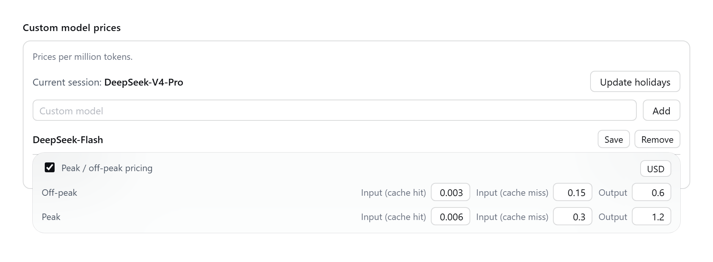

<h1 align="center">dsh-desktop-statusbar</h1>

<p align="center">
  <a href="https://github.com/raphael-y7/dsh-desktop-statusbar/stargazers"></a>
  <a href="https://www.npmjs.com/package/dsh-desktop-statusbar"></a>
  <a href="https://www.npmjs.com/package/dsh-desktop-statusbar"></a>
  <a href="https://github.com/deepseek-ai/deepseek-harness"></a>
  <a href="https://awesome-dsh-plugin.com/p/raphael-y7/dsh-desktop-statusbar/"></a>
  <a href="https://dshfind.com/zh/plugins/raphael-y7/dsh-desktop-statusbar"></a>
  <a href="https://deepseek1024.com/plugins/Rapheal-Y7/dsh-desktop-statusbar"></a>
  <br>
  <a href="https://nodejs.org/"></a>
  
  <a href="LICENSE"></a>
</p>

<p align="center"><a href="README.md">简体中文</a> | <a href="README.en.md">English</a> | <a href="README.ja.md">日本語</a> | <a href="README.es.md">Español</a> | <a href="README.fr.md">Français</a> | <a href="README.de.md">Deutsch</a> | <a href="README.ru.md">Русский</a> | <a href="README.pt.md">Português</a></p>

DSH デスクトップアプリのメッセージ入力欄下の統計行を、設定可能なステータスバーに置き換えます。フィールド、並び順、モデルごとの単価、通貨はいずれも設定でき、DeepSeek 公式のピーク／オフピーク料金でリアルタイムに費用を見積もります。

https://github.com/user-attachments/assets/73f78ed6-cca3-433c-9a96-e1e579fcb2a1

## 機能

- **9 つの任意フィールドとコンテキストリング**: コンテキスト占有率（バー先頭のリング）、ピーク／オフピーク判定、ターン数とステップ数、キャッシュヒット率、出力速度、TTFT、実行時間、今回のターン費用、セッション費用、残高
- **フィールドをクリックすると詳細を表示**:

  | フィールド | 内容 |
  | --- | --- |
  | コンテキストリング（バー先頭） | システムプロンプト / ツール定義 / メッセージ |
  | ピーク／オフピーク判定 | 使用ヒートマップ: 日 / 週 / 月 / 年 |
  | ターン数とステップ数 | コンテキスト圧縮 / 注入されたスキル / ツール呼び出し |
  | 総合ヒット率 | 今回のターン / 最高 / 最低のキャッシュヒット率 |
  | TPS | 今回のターン / 最速 / 最遅の速度 |
  | TTFT | 今回のターン / 最速 / 最遅の初回トークン遅延 |
  | 実行時間 | 待ち時間 / モデル時間 / ツール呼び出し |
  | 今回のターン費用 | 今回のターンのトークン内訳 |
  | セッション費用 | このセッションの累計トークン内訳 |
  | 残高 | チャージ残高 / 付与残高 / 残りクォータ |

- **セッションデータのドリルダウン**: コンテキスト圧縮は発生したノードをマークし、注入されたスキルはこのセッションで注入されたスキル数を示し、ツール呼び出しはセッションが使用したすべてのツールとその呼び出し回数を一覧表示します。タイトルをクリックすると上の階層に戻ります
- **バージョンチェックと更新**: DSH は起動時に最新バージョンを確認し、新しいバージョンがある場合は「ステータスバー」ナビ項目の横にヒントを表示し、設定画面にワンクリック更新ボタンを用意します
- **GitHub サポート**: ボタンをクリックすると GitHub プロジェクトページが開き、プロジェクトにスターを付けられます。
- **費用見積もり**: 公式のピーク／オフピーク規則で価格を計算します。各呼び出しは、それが発生した時刻と使用したモデルに基づいて計算されます
- **価格表**: 独自の単価、任意のピーク／オフピーク分割、人民元／米ドルの通貨切り替え
- **その他**: 祝日の自動更新、毎分更新される残高、8 言語の UI（簡体字中国語 / English / 日本語 / Español / Français / Deutsch / Русский / Português）

## インストール

DSH デスクトップアプリで **プラグイン → プラグインを追加** を開き、パッケージ名でインストールします:

```
dsh-desktop-statusbar
```

npm レジストリに到達できない場合、同じダイアログで中国本土のミラーをインストール元として選択できます。GitHub リポジトリの URL も使用できます:

```
https://github.com/raphael-y7/dsh-desktop-statusbar
```

コマンドライン:

```powershell
dsh plugin --profile desktop add dsh-desktop-statusbar
```

### npm からインストール

上記のどちらの方法も npm レジストリからインストールします。パッケージ名は `dsh-desktop-statusbar` です。npm 上の現在のバージョンを確認するには:

```powershell
npm view dsh-desktop-statusbar version
```

### 内蔵アップデータが失敗する場合

内蔵のワンクリック更新ボタンは、一部のデスクトップビルドで失敗することがあります。応答しないか、エラーを報告します。その場合は公式のインストール入口を使い、**パッケージ名に `@version` を付加** して正確なバージョンをインストールしてください:

```powershell
dsh plugin --profile desktop add dsh-desktop-statusbar@3.0.5
```

同じ文字列はプラグインパネルでも使えます。**プラグインを追加** 欄に `dsh-desktop-statusbar@3.0.5` と入力してください。

最新のバージョン（リリースページに表示されるもの、または上記の `npm view` の出力）を使用してください。バージョンを固定すると、**対象のビルドを正確にインストール** でき、古いキャッシュ済みパッケージを避けられます。

[dshmarket](https://awesome-dsh-plugin.com/p/raphael-y7/dsh-desktop-statusbar/)、[dshfind](https://dshfind.com/zh/plugins/raphael-y7/dsh-desktop-statusbar)、[1024Store](https://deepseek1024.com/plugins/Rapheal-Y7/dsh-desktop-statusbar) にも掲載されています。

## 使い方

**設定 → ステータスバー** を開きます:


- **コンテキスト占有率**: バー先頭のリング。進捗は使用済みコンテキストの割合を示し、隙間は圧縮しきい値を示し、色は実行状態を示します（アイドル-グレー / 実行中-緑 / サブエージェント実行中-青 / より深いサブエージェント実行中-紫 / エラー-赤 / 承認待ち-琥珀）
- **統計フィールド**: チェックは表示のみを制御するため、チェックを外してもフィールドは移動せず非表示になるだけです。右側のハンドルをドラッグして並べ替えます。「設定をリセット」で工場出荷時の順序に戻ります
- **カスタムモデル単価**: モデル名を入力して「追加」でエントリを作成します。「編集」でエディタが開き、保存時に変更が書き込まれます。「ピーク／オフピーク料金」にチェックすると時間帯で分割し、チェックしない場合は終日一律の料金が適用されます
- **通貨**: エディタ右上で人民元または米ドルを選択します。切り替えると、2 つの内蔵モデルがその通貨の公式参考価格に置き換わり（編集済みのエントリは保持）、費用フィールドの記号が変わります。残高は API が報告する通貨に従います
- **祝日**: 毎年 12 月 31 日以降に翌年分を自動取得して書き込みます
- **残高**: 1 分に 1 回更新されます

### 課金規則

ピーク時間帯は **北京時間の 09:00–12:00 と 14:00–18:00、月曜日から金曜日** で、オフピーク料金はピーク料金の半額です。中国の祝日と週末は終日オフピークで課金されます（[公式ドキュメント](https://api-docs.deepseek.com/quick_start/pricing) に準拠、2026-09 確認）。



## 中継所の残高照会

ステータスバーが残高を照会する際は、**現在のセッションで実際に使用しているプラットフォーム**に基づいて照会方法を選択します。自動マッチングと手動設定の 2 つのケースがあります。

### 1. 自動マッチング

中継所が DSH の **モデル** ページで通常の provider として設定されている場合（baseURL と API キーを備える）、プラグインはそのキーを用いて以下の一般的な残高エンドポイントを並行してプローブします。解析可能なエンドポイントが 1 つでも応答すれば、追加設定なしで残高を表示します:

- `/v1/usage`
- `/v1/user/self`、`/api/user/self`、`/api/v1/user/self`
- `/api/usage`
- `/v1/dashboard/billing/credit_grants`
- `/v1/credits`

当該サイトの残高エンドポイントが上記の標準的な形態に属し、`Authorization: Bearer <API キー>` で読み取れる場合は、残高が自動的に表示されます。

### 2. 手動設定

以下のいずれかに該当する場合は、**設定 → ステータスバー → カスタムモデル単価 → プラットフォーム** でプラットフォームのエントリを追加し、エンドポイントと資格情報を入力する必要があります:

- 当該 provider が **モデル** ページで baseURL を設定していない場合
- 残高エンドポイントまたは認証方式が標準的な形態に属さない場合（例: New API は追加のユーザー ID リクエストヘッダーを必要とする）
- エンドポイントのレスポンス構造を自動的に解析できない場合

各フィールドの定義は次のとおりです:

| フィールド | 説明 | 例 |
| --- | --- | --- |
| リクエストヘッダー | ユーザー ID に使用するリクエストヘッダー名。トークン認証は常に `authorization: Bearer` を使用するため入力不要 | `New-Api-User` |
| ユーザー ID | 上記リクエストヘッダーに用いるユーザー識別子 | `12345` |
| トークン | New API: 「アクセストークン」（個人設定のシステムアクセストークン）を入力。Sub2API: 「ログイントークン」を入力。通常の中継所: モデル呼び出しに用いる `sk-` キーを入力 | `sk-...` |
| 残高照会アドレス | 残高エンドポイントの完全な URL | `https://example.com/api/user/self` |
| 残高フィールド | 通貨記号、フィールドパス、除数。形式は `<通貨><フィールドパス> / <除数>` | `$data.quota / 500000` |
| 適用モデル | 当該プラットフォームに属するモデル | — |
| 費用倍率 | 課金倍率。デフォルトは 1 | `1` |

#### 例 1: New API 互換サイト

- 残高照会アドレス: `https://example.com/api/user/self`
- 残高フィールド: `$data.quota / 500000`（このサイトは 500000 クォータを 1 元として計算）
- トークン: 個人設定で生成したアクセストークン（モデル呼び出しキーではない）
- リクエストヘッダー: `New-Api-User`、ユーザー ID: アカウントのユーザー ID

#### 例 2: Sub2API サイト

Sub2API サイトの残高エンドポイントは、一般に次の 2 つの形態があります。サイトの実情に応じて選択してください:

- OpenAI 互換の `GET /v1/usage` をサポート（`sk-` モデルキーで認証）: 通常は自動マッチングされ、手動設定は不要です。命中しない場合は、トークンにその `sk-` キーを、残高照会アドレスに `https://example.com/v1/usage` を入力します。
- コンソールエンドポイントでのみ照会可能（エンドポイントは `/api/v1/*` 配下にあり、コンソールのログイン状態が必要）: 残高照会アドレスに当該サイトのコンソール残高エンドポイント（サイトの実情に準ずる）を入力し、**トークンには「ログイントークン」**（コンソールログイン後のアクセス資格情報であり、モデル呼び出しキーではない）を入力し、残高フィールドはエンドポイントのレスポンス構造に従って入力します。

#### 例 3: OpenAI 互換・単一キーの中継所

- トークン: モデル呼び出しに用いる `sk-` キー
- 通常は自動マッチングされます。命中しない場合は、残高照会アドレスと残高フィールド（例: `$balance` または `$data.balance`）を補足してください。

> 注: 残高照会アドレスを空欄にすると、当該プラットフォームの残高は照会されませんが、費用倍率に従って課金対象には含まれます。

## 既知の制限

- 最速／最遅の TTFT と速度は、新たなホスト側の集計に由来します。収集を開始する前に **DSH を完全に終了して再起動する必要があります**
- 価格が設定されていないモデルは課金されません。後から価格を追加すると、過去の呼び出しにも遡って適用されます
- ワンクリック更新は `pnpm` に依存します。デスクトップアプリはホストに同梱されたコピーを使用し、CLI / web での利用にはシステム上の `pnpm` が必要です。どちらも見つからない場合、更新はその旨を明示し、**試行したすべての場所をログに記録します**。`DSH_DESKTOP_STATUSBAR_PNPM` 環境変数で特定のコマンドを指定することもできます

## 権限と外部アクセス

このプラグインは、使用量・残高・費用を計算するためにセッションログとローカル設定を読み取り、ワンクリック自己更新をサポートするため、**高権限プラグイン**です。以下は実際の権限境界（`lib/` のコードに対応）です。インストール前に必ず確認してください。

### ファイル

| パス | 用途 | 備考 |
| --- | --- | --- |
| <DSH_HOME>/dsh-status-bar/usage-ledger.json | ローカルの使用量台帳。起動時に履歴から遡って補填 | プラグイン自身のディレクトリ内にのみ書き込み |
| <DSH_HOME>/dsh-status-bar/holidays.json | 祝日キャッシュ | バックグラウンドの祝日自動更新時に書き込み |
| <DSH_HOME>/dsh-status-bar/exchange-rate.json | 毎日の為替レートキャッシュ | バックグラウンドで為替レートを更新する際に書き込み |
| <DSH_HOME>/dsh-status-bar/tip-diag.log | 診断ログ | ツールチップ位置の診断情報を記録し、問題の切り分けに使用 |
| <DSH_HOME>/dsh-status-bar/relay-balance.json | リレー残高設定（平文のシークレットなし） | プラグインディレクトリ |
| <DSH_HOME>/sessions | セッションログを読み取り、トークン／費用統計を計算 | 読み取り専用 |
| <DSH_HOME>/.credentials.yaml | 認証情報サービスも環境変数も提供しない場合に限り、refs 経由で API キーを読み取り | 読み取り専用 |
| Profile `package.json` / `pnpm-lock.yaml` / `pnpm-workspace.yaml` | ワンクリック自己更新時にバックアップおよび書き戻し | 「ワンクリック更新」をクリックしたときのみ |

### ネットワーク

リクエストは残高・為替レート・祝日の表示、または更新確認のためにのみ行われ、ローカルループバック 127.0.0.1 を除き、すべて HTTPS 経由です。タイムアウト時は静かに失敗し、他のステータスバーフィールドをブロックしません。

| ドメイン | 用途 |
| --- | --- |
| `api.deepseek.com` | DeepSeek アカウント残高 |
| `openrouter.ai` | OpenRouter クレジット |
| `api.siliconflow.com` / `api.siliconflow.cn` | SiliconFlow アカウント情報 |
| `api.moonshot.ai` / `api.moonshot.cn` | Moonshot 残高 |
| `open.bigmodel.cn` / `api.z.ai` | Zhipu クォータ |
| `api.b.ai` | B.AI 残高 |
| `api.xiaomimimo.com` | Xiaomi MiMo 残高 |
| `api.stepfun.com` / `api.stepfun.ai` | StepFun アカウント残高（国内 / 国際） |
| `www.minimax.cn` | MiniMax Token Plan クォータ |
| `management-api.x.ai` | xAI チーム残高 |
| `business.aliyuncs.com` | Alibaba Cloud BSS アカウント残高 |
| `open.er-api.com` | 人民元の為替レート |
| `sousuo.www.gov.cn` | 法定祝日の自動更新 |
| `registry.npmjs.org` | バージョン確認（自己更新） |
| `127.0.0.1`（ループバック） | ホストの web ポート / ローカルアダプタ |

プラットフォームの残高 URL を空にすると、そのプラットフォームは照会されず、課金にも影響しません。

### 認証情報

- まずホストの認証情報サービス `ctx.credentials`（モデルページが書き込む権威あるソース）を使用します。利用できない場合は環境変数（例: `DEEPSEEK_API_KEY` と各アダプタの refs 名）にフォールバックし、次に `<DSH_HOME>/.credentials.yaml` の refs セクションにフォールバックします。
- API キーは **そのプラットフォームの残高照会にのみ使用されます**。他の場所にアップロードされたり、ログに記録されたり、台帳に書き込まれたりすることはありません。
- 設定ページではトークンをドットで表示し、選択してコピーできます。`GET /dsh-desktop-statusbar/api/relay-balance-config` は同一オリジンのトークンをフロントエンドに返します。このエンドポイントはループバック専用（Host / Origin / remoteAddress をチェック）で、マシンの外に出ることはありません。

### コマンド

- `pnpm` は「ワンクリック更新」をクリックしたときのみ呼び出されます。ホストに同梱された pnpm（例: `runtime/primary-runtime/dependencies/pnpm/bin/pnpm.mjs`）を優先し、なければシステムの `pnpm` にフォールバックします。`DSH_DESKTOP_STATUSBAR_PNPM` 環境変数で指定することもできます。
- 失敗時は更新が Profile のバックアップを復元し、理由を表示します。pnpm が見つからない場合は明示的に報告し、試行したすべての場所をログに記録します。

### 障害時の境界

- 認証情報なし: そのプラットフォームの残高は「—」と表示され、他のフィールドは動作し続けます。
- ネットワーク障害／タイムアウト: 影響を受けるのはその残高またはレートのみで、他の統計は影響を受けません。
- pnpm が見つからない: ワンクリック更新は静かに失敗する代わりに明示的にエラーを出します。
- 自己更新の失敗: Profile の `package.json` / ロックファイルのバックアップが復元されます。

### 既知のリスク

- 高権限プラグイン（ファイル読み書き + ネットワーク + 認証情報 + コマンド）— 権限の範囲を理解したうえで、インストールするかどうかを判断してください。
- 外部の残高サービスが利用できない場合、関連する数値は欠落または古くなります。
- ワンクリック自己更新には Profile ディレクトリへの書き込みアクセスが必要です。

## 開発

すべてのテストは素の node で実行することを想定したスタンドアロンスクリプトです — テストフレームワークはありません。

```powershell
npm test          # runs every verify*.js/.mjs under tests/, then checks project vs installed plugin dir
npm run sync      # copies lib/ into the installed plugin dir
```

`tools/` 配下の開発スクリプトはパッケージに同梱される（`files` フィールドに含まれる）ため、
git clone でも npm install でも入手できます:

| スクリプト | 用途 |
|---|---|
| `tools/test.cjs` | 完全なテスト実行 + 整合性ガード |
| `tools/sync-to-plugin.cjs` | プロジェクトの `lib/` → インストール済みプラグインディレクトリ |
| `tools/sync-from-plugin.cjs` | インストール済みプラグインディレクトリ → プロジェクトの `lib/` |
| `tools/plugin-dir.cjs` | プラグインディレクトリを特定 |
| `tools/shot.cjs` | README のスクリーンショットを再生成 |

これらは開発中にのみ使用され、プラグインが実行時に読み込むことはありません。
npm パッケージには `tests/` と `tools/` が含まれるため、インストールしたコピーでも
`node tools/test.cjs` を直接実行できます（全テスト実行 + 整合性ガード）。

プラグインディレクトリは自動的に特定されます。環境変数 `DSH_STATUS_BAR_PLUGIN_DIR` →
`~/.dsh` 配下の既知のレイアウト (`local-plugins/`、各 `profiles/*/node_modules/`) →
`tools/` の場所から導出されます。マシンやユーザー名を切り替えてもコード変更は不要です。

## ライセンス

[MIT](LICENSE): 自由に使用・改変・再配布できます。著作権およびライセンス表示を保持してください。
