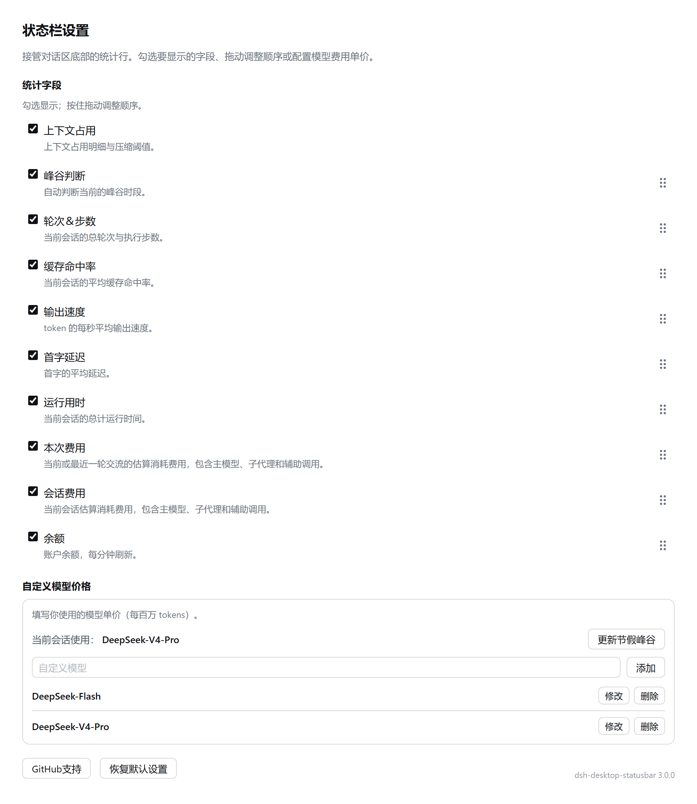
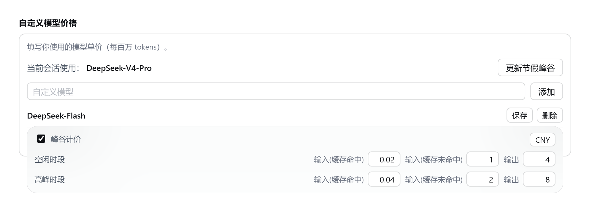

<h1 align="center">dsh-desktop-statusbar</h1>

<p align="center">
  <a href="https://github.com/raphael-y7/dsh-desktop-statusbar/stargazers"></a>
  <a href="https://www.npmjs.com/package/dsh-desktop-statusbar"></a>
  <a href="https://www.npmjs.com/package/dsh-desktop-statusbar"></a>
  <a href="https://github.com/deepseek-ai/deepseek-harness"></a>
  <a href="https://awesome-dsh-plugin.com/p/raphael-y7/dsh-desktop-statusbar/"></a>
  <a href="https://dshfind.com/zh/plugins/raphael-y7/dsh-desktop-statusbar"></a>
  <a href="https://deepseek1024.com/plugins/Rapheal-Y7/dsh-desktop-statusbar"></a>
  <br>
  <a href="https://nodejs.org/"></a>
  
  <a href="LICENSE"></a>
</p>

<p align="center">中文 | <a href="README.en.md">English</a></p>

以一条可配置的状态栏替换 DSH 桌面端对话区底部的统计行：字段、顺序、模型单价与计价单位均可配置，费用按官方峰谷口径实时估算。


## 功能

- **10 个可选字段**：上下文占用（栏首圆环）、峰谷判断、轮次＆步数、缓存命中率、输出速度、首字平均、运行用时、本轮费用、总计费用、余额
- **点击字段可查看详情**：

  | 字段 | 内容 |
  | --- | --- |
  | 上下文占用（栏首圆环） | 系统提示词 / 工具定义 / 对话消息 |
  | 峰谷判断 | 日 / 周 / 月 / 年数据统计热力图 |
  | 轮次＆步数 | 上下文压缩 / 技能注入 / 工具调用 |
  | 综合命中 | 本轮 / 最高 / 最低缓存命中率 |
  | 综合速度 | 本轮 / 最快 / 最慢速度 |
  | 首字平均 | 本轮 / 最快 / 最慢首字延迟 |
  | 运行用时 | 等待用时 / 模型用时 / 工具调用 |
  | 本轮费用 | 本轮会话的 token 明细 |
  | 总计费用 | 当前会话的累计 token 明细 |
  | 余额 | 充值余额 / 赠金余额 / 剩余配额；WorkBuddy 积分会话为「积分套餐」 |

- **会话数据下钻**：上下文压缩逐条标注发生节点（只列**成功**的压缩，手动 `/compact` 在行尾带上标星号）；技能注入**每个技能只列一行、不显示调用次数**，按「名字短的在前、名字长的在后」排序（`AGENTS.md` 这类全局提示词固定排第一；手动调用的技能名带上标星号）；工具调用按原始工具名列出（显示与排序规则见下一条）；点击标题返回上一层
- **工具调用显示原始工具名**：不翻译、不做中文名映射，直接显示工具调用时的**原始英文名**；按名字长度升序 → 调用次数降序 → 字典序排序；同名只列一次并计数（不同工具天然不同名，不会合并）；**永不折行**——放不下时先逐档增加每列行数（默认 3 行 → 4 → 5 …，上限 12 行），行数增加后列数变少、气泡宽度随之收窄；每列 12 行仍放不下才改为左右滚动。返回上一层后重置回 3 行。
- **工具彩条**：工具调用子视图标题下那条彩条按工具**显示顺序**取色，共 32 色（每 8 个一行，由浅到浓）；第 33 个工具循环回第 1 色。每段宽度 = 该工具次数 ÷ 总次数。
- **工具彩条悬停**：鼠标停在色段上只出现**一行 11px 纯文字**（工具名 + 占比，保留两位小数），没有气泡、没有阴影。文字**垂直方向固定**（与气泡标题行居中对齐，不随鼠标上下移动），只水平跟随鼠标；水平范围夹在「工具调用」标题右边界 +1 字符与彩条右边界之间。
- **色段悬停动效**：悬停时该色段纵向放大 1.45 倍、两端保持胶囊圆角、上下判定区各外扩 7px。这个动效**只在工具调用子视图**启用，余额 / 用时等其它条形图不参与。
- **子代理用量标色**：「本轮费用」/「总计费用」气泡里的分段条，有子代理用量时拆成 6 段：**子代理块在左、主会话块在右**——[子·命中 75% 灰][子·未命中 主色][子·输出 主色][主·命中 灰][主·未命中 紫][主·输出 蓝]。数字与三行明细仍是主会话 + 子代理的合并口径，不新增行。
- **WorkBuddy 积分套餐**：WorkBuddy（dsh-connect-workbuddy）会话里余额是积分，点击余额气泡会列出「积分套餐」：每包一块 = 包名 +（月度包的刷新日期 / 一次性包的到期日期）+ 已用 / 总量 + 一条进度条；相邻同名包合并成「包名×N」一块（日期取最近、标「(最近)」，右侧显示该组合计的已用 / 总量），点击聚合块可逐条查看每个原始包的名称、日期与各自已用 / 总量（一屏最多 5 块，超出可滚动，点标题返回）。**包名保持上游原名、不做翻译**（国际站以后还会出新包，映射表必然过期，漏翻反而更糟）；国内站包名里那串渠道前缀（`CodeBuddy` / `个人版` / `国内`）由插件**纯本地**剥掉，剥完就是干净的套餐名（如 `CodeBuddy个人版国内运营裂变包` → `运营裂变包`），两个界面都直接显示它。数据来自本机只读路由 `/plugins/dsh-connect-workbuddy/usage` 的 `credits.packages[]`（零新增网络请求、不碰凭据、不改第三方插件）；没有套餐数据时气泡保持不可点。
- **版本自检与更新**：DSH 启动时自动检测最新版本，发现新版时在「状态栏」导航项旁显示提示，并在设置页提供一键更新按钮
- **费用估算**：按官方峰谷口径计价，每条调用按其发生时刻与所用模型分别计算
- **总计怎么算**：每条调用**只结算一次**，算完就固化，之后永不重算 —— 所以改单价不会让已经记下的钱变样。改价之后新产生的 token 按**新价**结算。某个模型当时没有单价时，它的 token 先记成**欠账**，等你补上单价后只补算这部分欠账，历史金额不受影响。进度条里队友（子智能体）的部分按「当前值 − 已计入值」算增量，不会重复累加；也没有逐条时间戳，峰谷只能按当前时段估。
- **总计不闪**：队友用量是独立请求，上百个子会话时可能超时或迟到。请求失败的那一拍沿用上一次的值（不会从有数字退回横杠），也不会回退。子代理用量请求超时放宽到 20 秒，给大团队聚合留出时间。
- **价格库**：自定义单价、峰谷分档、CNY / USD 计价单位
- **GitHub支持**：用户的支持是开发者持续开发的最大动力！点击按钮转跳GitHub项目页，帮忙点亮Star支持一下，感谢各位！
- **其他**：节假日日历一键更新、账户余额每分钟刷新、中英双语、工具调用显示原始工具名

## 安装

在 DSH 桌面端打开 **插件 → 添加插件**，输入包名后安装：

```
dsh-desktop-statusbar
```

网络受限时，可在同一对话框内将安装源切换为「中国大陆镜像源」。亦支持 GitHub 仓库地址：

```
https://github.com/raphael-y7/dsh-desktop-statusbar
```

命令行方式：

```powershell
dsh plugin --profile desktop add dsh-desktop-statusbar
```

### 从 npm 安装

插件面板与命令行两种方式，安装源默认都是 npm registry，包名为 `dsh-desktop-statusbar`。想确认 npm 上的当前版本：

```powershell
npm view dsh-desktop-statusbar version
```

本插件亦收录于 [dshmarket](https://awesome-dsh-plugin.com/p/raphael-y7/dsh-desktop-statusbar/)、[dshfind](https://dshfind.com/zh/plugins/raphael-y7/dsh-desktop-statusbar) 与 [1024Store](https://deepseek1024.com/plugins/Rapheal-Y7/dsh-desktop-statusbar)。

## 使用

打开 **设置 → 状态栏**：



- **上下文占用**：栏首圆环，进度表示上下文占用比例，缺口表示上下文压缩阈值，颜色表示运行状态（空闲灰 / 运行绿 / 报错红 / 待审批黄）
- **统计字段**：勾选控制显示，取消勾选仅隐藏、不改变位置；拖动右侧把手调整顺序；「恢复默认设置」恢复出厂顺序并全选
- **自定义模型价格**：输入模型名并「添加」以新增条目；「修改」展开编辑区，保存后写入；需区分峰谷时段时勾选「峰谷计价」，否则按全天同价计算
- **计价单位**：价格编辑区右上角可选 CNY 或 USD。切换时内置的两款模型改用对应币种的官方参考价（已修改的条目保留），费用段的符号随之变化；余额按接口返回的币种显示
- **节假日**：点击「更新节假峰谷」获取并写入下一年的放假安排
- **余额**：每分钟自动刷新

### 计费口径

高峰时段为**北京时间周一至周五 9:00-12:00、14:00-18:00**，空闲价为高峰价的一半；法定节假日与周末全天按空闲价计费（与[官方文档](https://api-docs.deepseek.com/zh-cn/quick_start/pricing)一致，2026-09 核对）。

上下文压缩时摘要模型的真实调用也计入费用：压缩发生在某一轮进行中时**同时计入本轮与总计**，轮间 / 手动 `/compact` 压缩**只计入总计**，同一笔压缩不会重复计费。



## 已知限制

- 最快 / 最慢首字与速度来自 host 新增的投影，**升级后需完全退出并重启 DSH** 才开始统计
- 价格库中缺少单价的模型不计费，补充单价后自动补算
- 一键更新依赖 pnpm 可执行文件：桌面端用宿主随包提供的 pnpm，命令行 / 网页端用 PATH 上的 pnpm。两者都找不到时会明确提示「找不到 pnpm」，而不是静默失败
- 工具调用列表**永不折行**：先逐档增加每列行数（3 → 4 → … → 12）把列数压下来，气泡宽度随列数收窄（不多占横向空间、右侧不留白）；只有每列 12 行都放不下时才改为**左右滚动**，超过半屏高度时还可以上下滚动
- 工具调用统一显示原始英文工具名，不做中文翻译；同名工具合并计数，不同工具天然不同名、不会合并
- 本地配置键仍是 `dsh.desktopStatusBar.v1`，旧键 `dsh.miniStatusBar.v1` 会自动迁移；升级不会重置字段顺序、单价与币种
- 兼容 DeepSeek Harness **0.2.0-rc.2 及以后所有版本**（顶层 `engines.dsh` 声明无上界，仅表示安装放行，不代表未来版本的行为保证）

## 开发

每个测试都是独立脚本，直接用 node 跑，不需要任何测试框架。

```powershell
npm test          # runs every verify*.js under tests/, then checks project vs installed plugin dir
npm run sync      # copies lib/ into the installed plugin dir
```

`tools/` 下的开发脚本**随 npm 包一起发布**（在 `files` 清单里），方便想二次开发或本地调试的用户直接使用：

| 脚本 | 作用 |
|---|---|
| `tools/test.cjs` | 全量测试 + 一致性守卫 |
| `tools/sync-to-plugin.cjs` | 项目 `lib/` → 已安装插件目录 |
| `tools/sync-from-plugin.cjs` | 已安装插件目录 → 项目 `lib/` |
| `tools/plugin-dir.cjs` | 自动定位插件目录 |
| `tools/shot.cjs` | 生成 README 截图 |

它们只在开发时用，插件运行时不会加载、也**不会被自动触发**（需要手动 `node tools/xxx.cjs`）。
用 `npm test` / `npm run sync` 跑。

插件目录的位置自动探测，顺序是：环境变量 `DSH_STATUS_BAR_PLUGIN_DIR` → `~/.dsh` 下的已知安装布局
（`local-plugins/`、各 `profiles/*/node_modules/`）→ 由 `tools/` 位置推导。
换机器、换用户名都不用改代码。**插件自身运行时不依赖 `tools/`**：自更新靠
`lib/self-update.js` 从模块 URL 往上找到含 `package.json` 的包根。

## 许可

[MIT](LICENSE)：可自由使用、修改与再分发；保留版权与许可声明即可。
