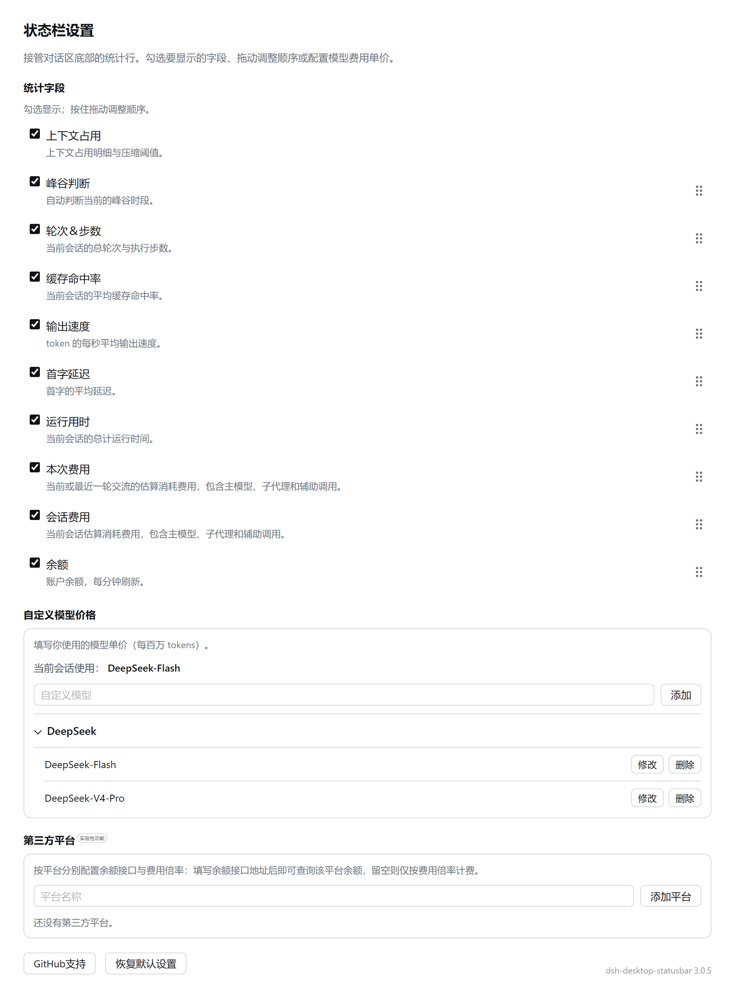
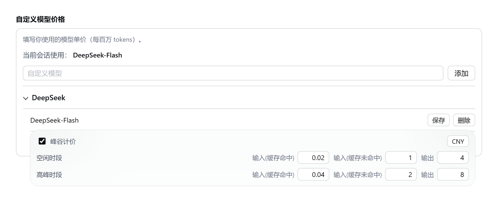

<h1 align="center">dsh-desktop-statusbar</h1>

<p align="center">
  <a href="https://github.com/raphael-y7/dsh-desktop-statusbar/stargazers"></a>
  <a href="https://www.npmjs.com/package/dsh-desktop-statusbar"></a>
  <a href="https://www.npmjs.com/package/dsh-desktop-statusbar"></a>
  <a href="https://github.com/deepseek-ai/deepseek-harness"></a>
  <a href="https://awesome-dsh-plugin.com/p/raphael-y7/dsh-desktop-statusbar/"></a>
  <a href="https://dshfind.com/zh/plugins/raphael-y7/dsh-desktop-statusbar"></a>
  <a href="https://deepseek1024.com/plugins/Rapheal-Y7/dsh-desktop-statusbar"></a>
  <br>
  <a href="https://nodejs.org/"></a>
  
  <a href="LICENSE"></a>
</p>

<p align="center"><a href="README.md">简体中文</a> | <a href="README.en.md">English</a> | <a href="README.ja.md">日本語</a> | <a href="README.es.md">Español</a> | <a href="README.fr.md">Français</a> | <a href="README.de.md">Deutsch</a> | <a href="README.ru.md">Русский</a> | <a href="README.pt.md">Português</a></p>

以一条可配置的状态栏替换 DSH 桌面端对话区底部的统计行：字段、顺序、模型单价与计价单位均可配置，费用按官方峰谷口径实时估算。

<video src="https://github.com/user-attachments/assets/5a4f7fd8-a445-490d-a557-1ec840c611df" controls muted playsinline width="720"></video>

## 功能

- **9 个可选字段 + 栏首上下文圆环**：上下文占用（栏首圆环）、峰谷判断、轮次＆步数、缓存命中率、输出速度、首字平均、运行用时、本轮费用、总计费用、余额
- **点击字段可查看详情**：

  | 字段 | 内容 |
  | --- | --- |
  | 上下文占用（栏首圆环） | 系统提示词 / 工具定义 / 对话消息 |
  | 峰谷判断 | 日 / 周 / 月 / 年数据统计热力图 |
  | 轮次＆步数 | 上下文压缩 / 技能注入 / 工具调用 |
  | 综合命中 | 本轮 / 最高 / 最低缓存命中率 |
  | 综合速度 | 本轮 / 最快 / 最慢速度 |
  | 首字平均 | 本轮 / 最快 / 最慢首字延迟 |
  | 运行用时 | 等待用时 / 模型用时 / 工具调用 |
  | 本轮费用 | 本轮会话的 token 明细 |
  | 总计费用 | 当前会话的累计 token 明细 |
  | 余额 | 充值余额 / 赠金余额 / 剩余配额 |

- **会话数据下钻**：上下文压缩逐次标注发生节点，技能注入统计当前会话注入的技能，工具调用列出会话使用的所有工具与各自次数；点击标题返回上一层
- **版本自检与更新**：DSH 启动时自动检测最新版本，发现新版时在「状态栏」导航项旁显示提示，并在设置页提供一键更新按钮
- **费用估算**：按官方峰谷口径计价，每条调用按其发生时刻与所用模型分别计算
- **价格库**：自定义单价、峰谷分档、CNY / USD 计价单位
- **GitHub 支持**：点击按钮跳转至 GitHub 项目页，可为项目点亮 Star。
- **其他**：节假日自动更新、账户余额每分钟刷新、8 种界面语言（简体中文 / English / 日本語 / Español / Français / Deutsch / Русский / Português）

## 安装

在 DSH 桌面端打开 **插件 → 添加插件**，输入包名后安装：

```
dsh-desktop-statusbar
```

网络受限时，可在同一对话框内将安装源切换为「中国大陆镜像源」。亦支持 GitHub 仓库地址：

```
https://github.com/raphael-y7/dsh-desktop-statusbar
```

命令行方式：

```powershell
dsh plugin --profile desktop add dsh-desktop-statusbar
```

### 从 npm 安装

插件面板与命令行两种方式，安装源默认都是 npm registry，包名为 `dsh-desktop-statusbar`。想确认 npm 上的当前版本：

```powershell
npm view dsh-desktop-statusbar version
```

### 插件自带的更新失效时

插件内置的一键更新按钮在部分桌面端版本上可能失效（无响应或直接报错）。此时应改用官方安装入口，**在包名后追加 `@版本号`** 指定具体版本以精确安装：

```powershell
dsh plugin --profile desktop add dsh-desktop-statusbar@3.0.5
```

插件面板中同样可以这样填写：在「添加插件」的输入框内填写 `dsh-desktop-statusbar@3.0.5`。

版本号填写当前最新版本即可（发布页右侧的版本号，或上述 `npm view` 命令的输出）。指定版本还可确保**安装的正是目标版本**，避免因缓存获取到旧包。

本插件亦收录于 [dshmarket](https://awesome-dsh-plugin.com/p/raphael-y7/dsh-desktop-statusbar/)、[dshfind](https://dshfind.com/zh/plugins/raphael-y7/dsh-desktop-statusbar) 与 [1024Store](https://deepseek1024.com/plugins/Rapheal-Y7/dsh-desktop-statusbar)。

## 使用

打开 **设置 → 状态栏**：



- **上下文占用**：栏首圆环，进度表示上下文占用比例，缺口表示上下文压缩阈值，颜色表示运行状态（空闲-灰 / 运行-绿 / 子智能体在跑-蓝 / 更深层子智能体在跑-紫 / 报错-红 / 待审批-黄）
- **统计字段**：勾选控制显示，取消勾选仅隐藏、不改变位置；拖动右侧把手调整顺序；「恢复默认设置」恢复出厂顺序并全选
- **自定义模型价格**：输入模型名并「添加」以新增条目；「修改」展开编辑区，保存后写入；需区分峰谷时段时勾选「峰谷计价」，否则按全天同价计算
- **计价单位**：价格编辑区右上角可选 CNY 或 USD。切换时内置的两款模型改用对应币种的官方参考价（已修改的条目保留），费用段的符号随之变化；余额按接口返回的币种显示
- **节假日**：每年 12 月 31 日后自动获取并写入下一年
- **余额**：每分钟自动刷新

### 计费口径

高峰时段为**北京时间周一至周五 9:00-12:00、14:00-18:00**，空闲价为高峰价的一半；法定节假日与周末全天按空闲价计费（与[官方文档](https://api-docs.deepseek.com/zh-cn/quick_start/pricing)一致，2026-09 核对）。



## 中转站余额查询

状态栏查询余额时，依据「当前会话实际使用的平台」选择查询方式，分为自动匹配与手动配置两种情形。

### 一、自动匹配

当中转站已作为普通 provider 配置于 DSH「模型」页（具备 baseURL 与 API 密钥）时，插件将使用该密钥并发探测下列常见余额接口；命中任一可解析接口即显示余额，无需额外配置：

- `/v1/usage`
- `/v1/user/self`、`/api/user/self`、`/api/v1/user/self`
- `/api/usage`
- `/v1/dashboard/billing/credit_grants`
- `/v1/credits`

若该站余额接口属于上述标准形态，且可通过 `Authorization: Bearer <API 密钥>` 读取，即可自动显示余额。

### 二、手动配置

出现下列任一情形时，须在「设置 → 状态栏 → 自定义模型价格 → 平台」中新增平台条目，并填写接口与凭据：

- 该 provider 未在「模型」页配置 baseURL；
- 余额接口或鉴权方式不属于标准形态（例如 New API 需额外的用户 ID 请求头）；
- 接口返回结构无法自动解析。

各字段定义如下：

| 字段 | 说明 | 示例 |
| --- | --- | --- |
| 请求头 | 用户 ID 所使用的请求头名称；令牌鉴权固定采用 `authorization: Bearer`，无需填写 | `New-Api-User` |
| 用户 ID | 用于上述请求头的用户标识 | `12345` |
| 令牌 | New API：填「访问令牌」（个人设置中的系统访问令牌）；Sub2API：填「登录令牌」；普通中转站：填调用模型所用的 `sk-` 密钥 | `sk-...` |
| 余额查询地址 | 余额接口的完整 URL | `https://example.com/api/user/self` |
| 余额字段 | 币种符号、字段路径与除数，格式为 `<币种><字段路径> / <除数>` | `$data.quota / 500000` |
| 适用模型 | 归属该平台的模型 | — |
| 费用倍率 | 计价倍率，默认 1 | `1` |

#### 示例一：New API 兼容站点

- 余额查询地址：`https://example.com/api/user/self`
- 余额字段：`$data.quota / 500000`（该站点以 500000 额度计 1 元）
- 令牌：个人设置中生成的访问令牌（非模型调用密钥）
- 请求头：`New-Api-User`；用户 ID：账户用户 ID

#### 示例二：Sub2API 站点

Sub2API 站点的余额接口常见以下两种形态，按站点实际情况选择：

- 支持 OpenAI 兼容的 `GET /v1/usage`（以 `sk-` 模型密钥鉴权）：通常可自动匹配，无需手动配置；若未命中，令牌填该 `sk-` 密钥，余额查询地址填 `https://example.com/v1/usage`。
- 仅控制台接口可查（接口位于 `/api/v1/*`，需控制台登录态）：余额查询地址填该站控制台余额接口（以站点实际为准），**令牌填「登录令牌」**（控制台登录后的访问凭证，非模型调用密钥），余额字段按接口返回结构填写。

#### 示例三：OpenAI 兼容、单一密钥的中转站

- 令牌：调用模型所用的 `sk-` 密钥
- 通常可自动匹配；若未命中，补充余额查询地址与余额字段（如 `$balance` 或 `$data.balance`）。

> 注：余额查询地址留空时，该平台不查询余额，仍按费用倍率参与计费。

## 已知限制

- 最快 / 最慢首字与速度来自 host 新增的投影，**升级后需完全退出并重启 DSH** 才开始统计
- 价格库中缺少单价的模型不计费，补充单价后自动补算
- 一键更新依赖 pnpm 可执行文件：桌面端用宿主随包提供的 pnpm，命令行 / 网页端需要系统里有 `pnpm`。都找不到时会明确提示「找不到 pnpm」，并把**尝试过的每个位置**一并写进日志；也可以用环境变量 `DSH_DESKTOP_STATUSBAR_PNPM` 直接指定要用的命令

## 权限与外部访问

本插件需要读取会话日志与本地配置来统计用量、余额和费用，并支持一键自更新，因此是一个**高权限插件**。以下为真实权限边界（与 `lib/` 代码一致），安装前请知悉。

### 文件

| 路径 | 用途 | 说明 |
| --- | --- | --- |
| `<DSH_HOME>/dsh-status-bar/usage-ledger.json` | 本地用量台账，启动时回填历史用量 | 只写本插件自己的目录 |
| `<DSH_HOME>/dsh-status-bar/holidays.json` | 法定节假日缓存 | 后台自动更新节假日时写入 |
| `<DSH_HOME>/dsh-status-bar/exchange-rate.json` | 每日汇率缓存 | 后台更新汇率时写入 |
| `<DSH_HOME>/dsh-status-bar/tip-diag.log` | 诊断日志 | 记录气泡定位诊断信息，便于排查问题 |
| `<DSH_HOME>/dsh-status-bar/relay-balance.json` | 中转站余额配置（不含明文密钥） | 本插件目录 |
| `<DSH_HOME>/sessions` | 读取会话日志用于统计 token / 费用 | 只读 |
| `<DSH_HOME>/.credentials.yaml` | 仅当凭据服务与环境变量都取不到时，按 refs 读取 API key | 只读 |
| Profile 的 `package.json` / `pnpm-lock.yaml` / `pnpm-workspace.yaml` | 一键自更新时备份并写回 | 仅在你点击「一键更新」时 |

### 网络

仅在需要显示余额、汇率、节假日或检查更新时发起请求，除本机回环 127.0.0.1 外，其余均为 HTTPS，超时后安静失败（不影响状态栏其它字段）。

| 域名 | 用途 |
| --- | --- |
| `api.deepseek.com` | DeepSeek 账户余额 |
| `openrouter.ai` | OpenRouter 额度 |
| `api.siliconflow.com` / `api.siliconflow.cn` | 硅基流动账户信息 |
| `api.moonshot.ai` / `api.moonshot.cn` | Moonshot 余额 |
| `open.bigmodel.cn` / `api.z.ai` | 智谱额度 / 配额 |
| `api.b.ai` | B.AI 余额 |
| `api.xiaomimimo.com` | 小米 MiMo 余额 |
| `api.stepfun.com` / `api.stepfun.ai` | StepFun 账户余额（国内 / 国际） |
| `www.minimax.cn` | MiniMax Token Plan 额度 |
| `management-api.x.ai` | xAI 团队余额 |
| `business.aliyuncs.com` | 阿里云 BSS 账户余额 |
| `open.er-api.com` | 人民币汇率 |
| `sousuo.www.gov.cn` | 自动更新法定节假日 |
| `registry.npmjs.org` | 版本检查（自更新） |
| `127.0.0.1`（本机回环） | 宿主 Web 端口 / 本地适配器 |

余额查询地址留空即不查询该平台，也不会因此计费出错。

### 凭据

- 优先使用宿主凭据服务 `ctx.credentials`（模型页写入的权威来源）；取不到时依次退回环境变量（如 `DEEPSEEK_API_KEY` 以及各平台适配器的 refs 名）、再到 `<DSH_HOME>/.credentials.yaml` 的 refs 段。
- API key **只用于向对应平台发起余额查询**，不会上传到其它服务、不写入日志、不写入台账。
- 设置页的令牌显示为圆点并可选中复制；`GET /dsh-desktop-statusbar/api/relay-balance-config` 会把本机同源的令牌回传前端 —— 该接口仅限本机回环（Host / Origin / remoteAddress 三重校验），不会外发。

### 命令

- 仅在你点击「一键更新」时调用 `pnpm`：优先使用宿主随包提供的 pnpm（如 `runtime/primary-runtime/dependencies/pnpm/bin/pnpm.mjs`），找不到才退回系统 `pnpm`；可用环境变量 `DSH_DESKTOP_STATUSBAR_PNPM` 指定。
- 更新失败会恢复 Profile 备份并显示原因；找不到 pnpm 时会明确报错并列出尝试过的每个位置。

### 失败边界

- 取不到凭据：对应平台的余额显示「—」，其它字段照常。
- 网络失败 / 超时：只影响该次余额或汇率，状态栏其它统计不受影响。
- 找不到 pnpm：一键更新明确报错，不会静默失败。
- 自更新失败：恢复 Profile 的 `package.json` / 锁文件备份。

### 已知风险

- 本插件是高权限插件（文件读写 + 网络 + 凭据 + 命令），请在了解权限范围后再决定是否安装。
- 外部余额服务不可用时相关数字会缺失或滞后。
- 一键自更新需要对 Profile 目录的文件写权限。

## 开发

每个测试都是独立脚本，直接用 node 跑，不需要任何测试框架。

```powershell
npm test          # runs every verify*.js/.mjs under tests/, then checks project vs installed plugin dir
npm run sync      # copies lib/ into the installed plugin dir
```

`tools/` 下的开发脚本随包一起发布（`files` 里有它），克隆仓库或装 npm 包都能拿到：

| 脚本 | 作用 |
|---|---|
| `tools/test.cjs` | 全量测试 + 一致性守卫 |
| `tools/sync-to-plugin.cjs` | 项目 `lib/` → 已安装插件目录 |
| `tools/sync-from-plugin.cjs` | 已安装插件目录 → 项目 `lib/` |
| `tools/plugin-dir.cjs` | 自动定位插件目录 |
| `tools/shot.cjs` | 生成 README 截图 |

它们只在开发时用，插件运行时不会加载。npm 包已包含 `tests/` 与 `tools/`，
安装后可直接运行 `node tools/test.cjs`（全量测试 + 一致性守卫）。

插件目录的位置自动探测，顺序是：环境变量 `DSH_STATUS_BAR_PLUGIN_DIR` → `~/.dsh` 下的已知安装布局
（`local-plugins/`、各 `profiles/*/node_modules/`）→ 由 `tools/` 位置推导。换机器、换用户名都不用改代码。

## 许可

[MIT](LICENSE)：可自由使用、修改与再分发；保留版权与许可声明即可。
